<div align="center">



<a href="https://git.io/typing-svg">
  
</a>

<br/><br/>


</div>

---

## 🎮 PLAYER PROFILE

```yaml
╔══════════════════════════════════════════════╗
║  NAME      : Diki Ramdani                    ║
║  CLASS     : Web Developer (Backend Mage)    ║
║  GUILD     : Freelance / Open Source         ║
║  LOCATION  : Indonesia                       ║
║  MAIN QUEST: Aluen Attendify                 ║
║  MOTTO     : "Never stop leveling up."       ║
╚══════════════════════════════════════════════╝
```

---

## ⚔️ SKILL TREE

```
LARAVEL      ████████████████░░░░  80%   [ LV.8 ]
PHP          █████████████████░░░  85%   [ LV.9 ]
MYSQL        ██████████████░░░░░░  70%   [ LV.7 ]
JAVASCRIPT   █████████████░░░░░░░  65%   [ LV.6 ]
TAILWIND CSS ██████████████░░░░░░  70%   [ LV.7 ]
FLUTTER      ████████░░░░░░░░░░░░  40%   [ LV.4 ]
```

<div align="center">

### 🧰 INVENTORY (Tech Stack)


</div>

---

## 🗺️ QUEST LOG (Proyek)

<div align="center">

| 🏆 Quest | 📜 Deskripsi | 🔄 Update Terakhir |
|:--|:--|:--|
| **[Aluen Attendify](https://github.com/dkrmd1/aluen-attendify)** | Platform absensi dengan Laravel API & mobile app |  |
| **[Company Profile Outsourcing](https://github.com/dkrmd1/Company-Profile-Outsourcing)** | Website company profile jasa outsourcing |  |
| **[Portfolio Diki](https://github.com/dkrmd1/portfolio-diki)** | Website portofolio pribadi |  |

</div>

---

## 📡 CONNECT WITH PLAYER

<div align="center">

<a href="https://dkrmd1.github.io"></a>
<a href="https://linkedin.com/in/USERNAME-KAMU"></a>
<a href="https://instagram.com/USERNAME-KAMU"></a>
<a href="mailto:EMAIL-KAMU@gmail.com"></a>

<br/><br/>


</div>

<!-- akhir halaman -->

<!--
=====================================================
 TAMBAHAN OPSIONAL (coba satu per satu, tempel di atas
 bagian CONNECT WITH PLAYER). Server gratis ini kadang
 down, jadi kalau tidak muncul coba lagi nanti.
=====================================================

Kartu statistik:
<div align="center">


</div>

Streak:
<div align="center">

</div>

Piala:
<div align="center">

</div>

Ular (WAJIB bikin workflow dulu, lihat di bawah):
<div align="center">

</div>

 Workflow snake: buat file .github/workflows/snake.yml

 name: Generate Snake
 on:
   schedule:
     - cron: "0 */12 * * *"
   workflow_dispatch:
 permissions:
   contents: write
 jobs:
   generate:
     runs-on: ubuntu-latest
     steps:
       - uses: Platane/snk/svg-only@v3
         with:
           github_user_name: ${{ github.repository_owner }}
           outputs: |
             dist/github-snake-dark.svg?palette=github-dark
       - uses: crazy-max/ghaction-github-pages@v3.1.0
         with:
           target_branch: output
           build_dir: dist
         env:
           GITHUB_TOKEN: ${{ secrets.GITHUB_TOKEN }}

 Lalu tab Actions -> Generate Snake -> Run workflow.
=====================================================
-->
